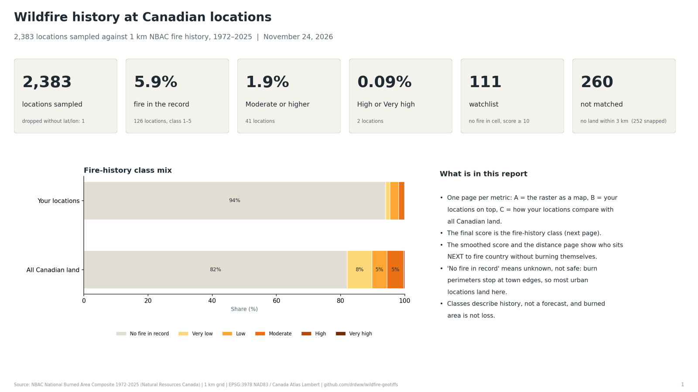
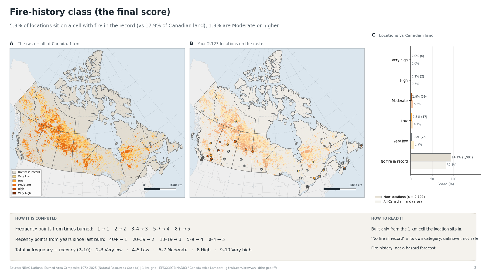
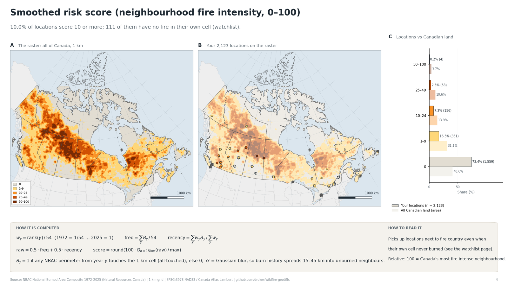
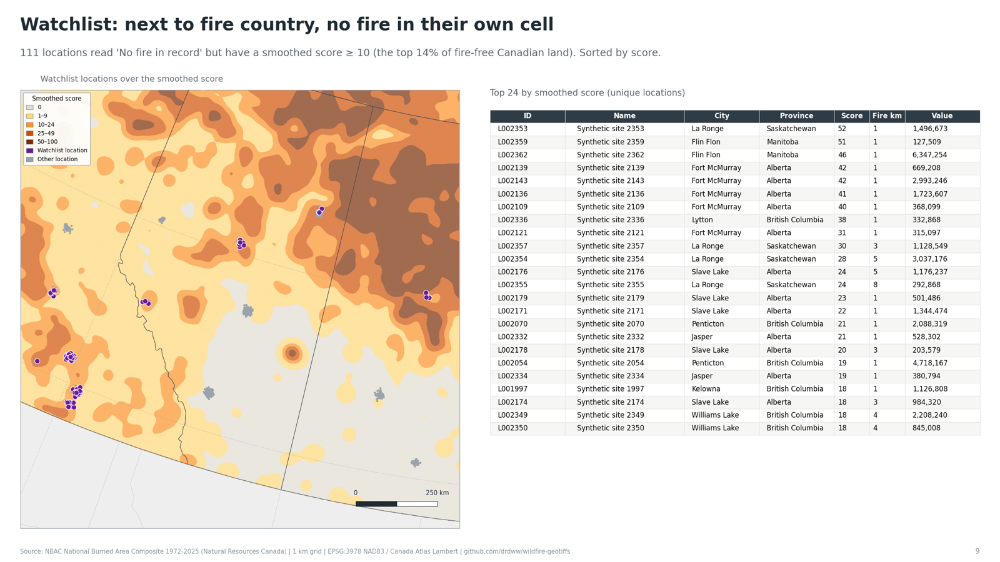

# Canada wildfire-history report

`canada_wildfire_report.py` is a single notebook cell that samples the six Canada rasters at
your locations and writes a 16:9 PDF report, one PNG per page for slides, and your rows back
out with the sampled `wf_*` columns.

## Run it

1. Put the six Canada rasters in one folder (the `tifs/` folder of
   `wildfire_CANADA_1km.zip`).
2. Copy the whole file into one notebook cell (Databricks, Jupyter or Colab).
3. Edit the four paths at the top: `BASE_DIR`, `POINTS_FILE` (.xlsx or .csv), `TIF_DIR`,
   `OUT_DIR`. Set `VALUE_COL` if you want insured value in the tables.
4. Run. It takes about 2 minutes, mostly drawing the maps.

Needs `numpy pandas rasterio pyproj scipy matplotlib openpyxl`, plus `geopandas` for the
province outlines.

**Columns are detected automatically:** `Latitude` / `Longitude`, `CountryCode` (keeps
CA / CAN / Canada), `LOCID`, `LOCNAME`, `CityName` and `Admin1Name`, or common variants such as
`lat`, `lon` and `province`. If a name differs, set `LAT_COL`, `LON_COL` and the others.

**Province outlines** are read from `boundaries/na_admin1.geojson`. The script looks next to
the `tifs/` folder first, then downloads the file from this repo. If neither works, it draws
the land-mask outline instead.

## The pages

| Page | Content |
|---|---|
| 1 | Summary tiles and the class mix of your locations against all Canadian land |
| 2 | Data, sampling method, every formula, caveats |
| 3–8 | One page per metric: **A** the raster as a map, **B** your locations on top, **C** the distribution of your locations against all Canadian land, plus the formula |
| 9 | Watchlist: locations with no fire in their own cell but a high smoothed score |
| 10 | Highest fire-history class, sorted by class and then score |
| 11 | By province (uses `Admin1Name`, or a spatial join when that column is missing) |

The metric pages, in order:

1. fire-history class (the final score)
2. smoothed score
3. distance to the nearest mapped fire
4. times burned
5. time since last burn
6. recent fire, 2021–2025

Each metric is binned the same way on the map, the points and the bars, so one colour means
the same thing in all three panels.

## Columns added to your rows

| Column | Meaning |
|---|---|
| `wf_matched` | the point found a land cell (directly or within `SNAP_KM`) |
| `wf_snap_km` | how far it was moved onto land (0 = not moved) |
| `wf_class_5cat`, `wf_class_label` | **final score**: 0 No fire in record, 1 Very low … 5 Very high |
| `wf_score_0_100` | smoothed score, relative to Canada's maximum |
| `wf_km_to_fire` | distance from the cell to the nearest cell that burned in 1972–2025 |
| `wf_times_burned` | years with fire, 1972–2025 |
| `wf_burn_rate_1972_2025`, `wf_burn_rate_2021_2025` | share of years with fire |
| `wf_tslb_yr`, `wf_last_burn_year` | years since the last burn (counted back from 2025), and that year; `-1` / blank = none in the record |
| `wf_watchlist` | class = No fire in record and smoothed score ≥ `WATCH_SCORE` (default 10) |

The distance layer is computed inside the script, with an exact Euclidean distance transform
of `nburns_canada_1km`. It is not a separate file.

## Preview

These pages were made from **synthetic** locations (jittered points around Canadian cities).
Some fall in lakes or the sea, which is why they show as unmatched.

